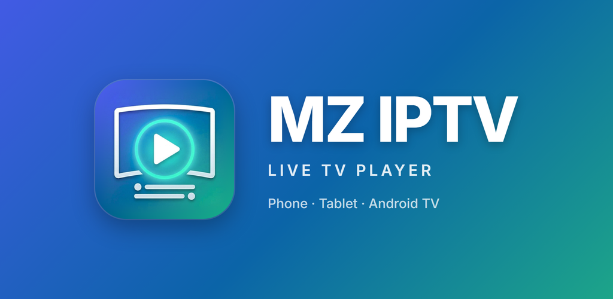
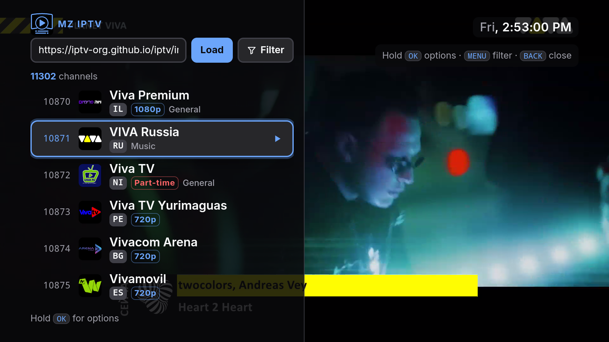
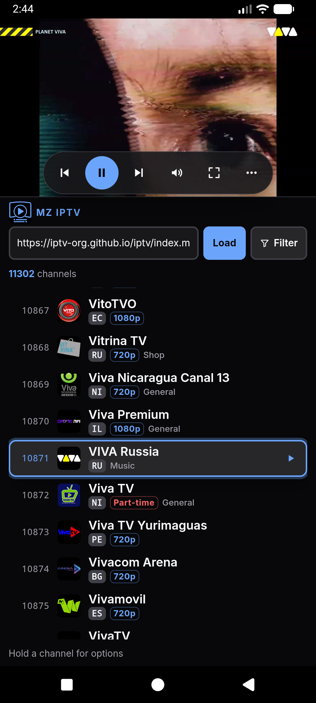
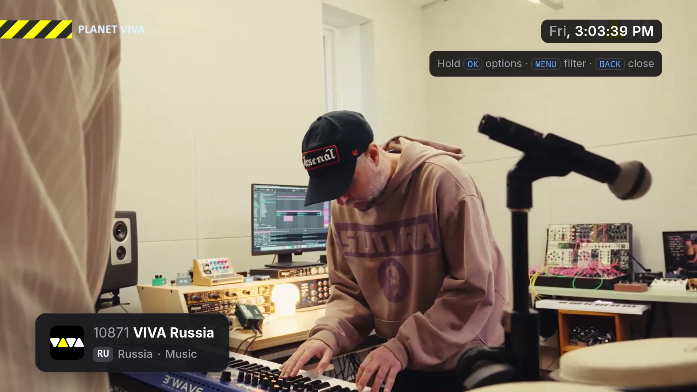
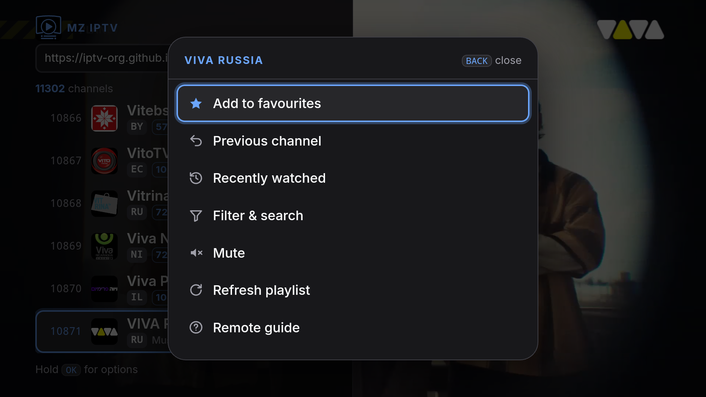
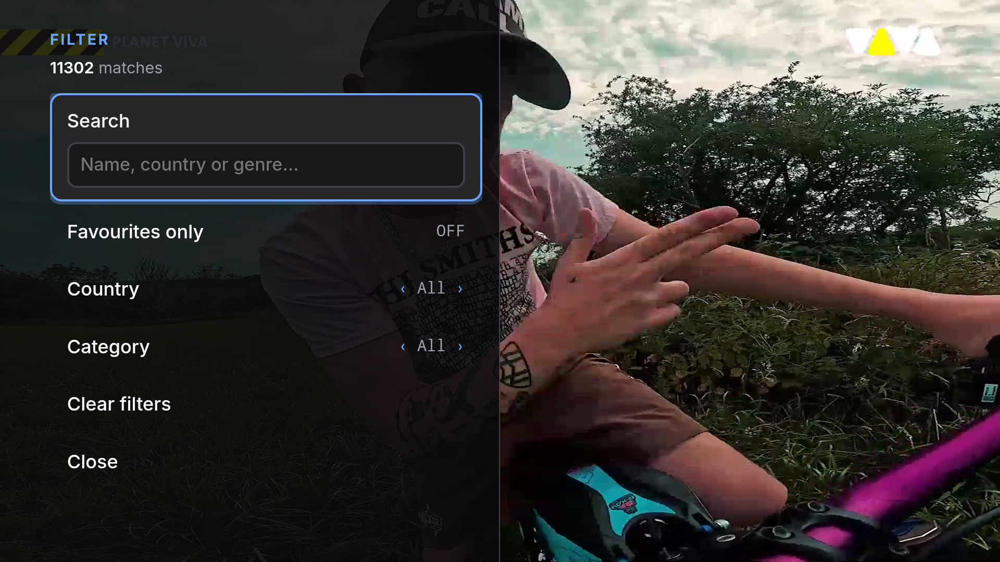
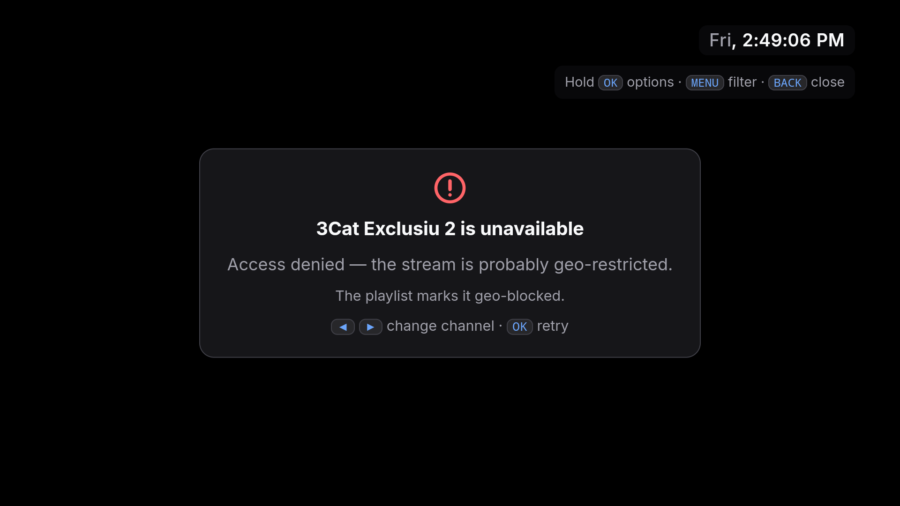

# MZ IPTV Player



A live TV player for **Android TV, phones, tablets and the browser**. Load an M3U playlist and browse thousands of channels with a TV remote, touch, keyboard or mouse. It comes ready to go with the public [iptv-org](https://github.com/iptv-org/iptv) playlist: open it and pick a channel.

> **This is only a player.** It doesn't host, store or supply any streams. It plays the links in the playlist you load, and you're responsible for what you load. Channels in public playlists are run by their owners: some are geo-restricted, some go offline, and the player tells you when that happens.

## Features
- **One app for every screen.** The same APK works on Android TV / Google TV with a remote, and on phones and tablets with touch. The same interface also runs in any modern browser.
- **Built for the remote.** Big, readable 10-foot layout. D-pad navigation with a clear focus outline. Hold OK for options, plus CH±, number keys and the colour buttons.
- **Ready out of the box.** The iptv-org playlist (about 11,000 channels) loads on first start and refreshes itself in the background.
- **Channel info at a glance.** Country, resolution, genre, and "Geo-blocked" / "Part-time" tags under every channel, with the full country name on hover.
- **Find things fast.** Search by name, country or genre. Filter by country, category or favourites, or jump to a channel by number.
- **Favourites and history.** They follow the channel itself, not its stream link, so they survive playlist updates.
- **Phone-friendly.** In portrait, the video sits on top with the list below; in landscape, the video is full screen with a see-through list. Swipe on the video to change channel, hold a channel for options.
- **Plays the common IPTV formats.** HLS, DASH and plain HTTP streams (TS, MP4) in the app, with hardware video decoding.
- **Runs on older TV boxes too.** Works on Android 9 boxes with the WebView they shipped with, which is often years out of date.
- **Clear errors.** When a channel can't play you get the reason (geo-restricted, offline, needs a login, unsupported format) with Retry and Next buttons.
- **Private and self-contained.** No accounts, no tracking, no ads, nothing loaded from CDNs. The only network traffic is the playlist, the streams and channel logos.
- **Accessible.** Text and focus outlines meet WCAG AA contrast, checked automatically over both dark and bright video.

## Screenshots
<p align="center">
  &nbsp;
  
</p>
<p align="center">
  &nbsp;
  
  &nbsp;
  
</p>

<sub>Real captures: the Android TV emulator (1080p) and an Android phone, playing channels from the public iptv-org playlist.</sub>

## Install

### Android (phone, tablet, Android TV)
Requires Android 9 or newer. The menus work with the Android System WebView that Android 9 ships with (version 66) and anything newer; if a device's WebView is older than 62, the app says so once (with a Play Store link when the WebView can be updated there). Plays HLS, DASH and plain HTTP (TS / MP4) streams.

1. Download the APK from this repository's **Releases** page, or [build it yourself](#build-from-source).
2. **Phone or tablet:** open the APK and allow *Install unknown apps* for the app you opened it from (Files, Chrome, …). If Google Play Protect warns that the app is unknown, tap *More details → Install anyway*.
3. **Android TV / Google TV:** copy the APK onto the TV with a USB stick or the *Downloader* app, or install it from a computer with `adb install MZ-IPTV-Player-<version>-release.apk`. The app then appears in the TV's Apps row with its banner.

Installing a newer APK over an existing one updates it and keeps your favourites and settings.

### Browser
Open `web/index.html` in a modern browser on a desktop, phone or tablet. Tested in Chrome, Edge and Firefox (including playback), and in WebKit, Safari's engine (layout and controls). Browsers play HLS and MP4 / WebM; DASH streams and streams that need special request headers only play in the Android app. You can open it straight from disk or serve the `web/` folder from any web server. Keep `web/vendor/` and `web/icons/` next to `index.html`.

## How to use

### TV remote
| Button | Action |
|---|---|
| ▲ ▼ | Browse channels (hold to speed up). ▲ on the first channel reaches the playlist URL bar |
| OK | Play the channel · **hold** for options (favourite, previous channel, recent, filter & search, mute, refresh playlist, guide) |
| ◀ ▶ | Previous / next channel |
| BACK | Close the list or menu · press twice on the video to exit |
| MENU | Options (same as holding OK) |
| CH+ / CH− | Page through the list when it's open, otherwise change channel |
| ⏪ ⏩ / ⏮ ⏭ | Previous / next channel (live TV can't rewind) |
| ▶❚❚ · ⏹ | Pause / resume (resumes at the live edge) · stop pauses |
| 0–9 | Jump to a channel number |
| 🔴 🟢 🟡 🔵 | Favourite · Recent · Filter · Previous channel |
| 🔖 Bookmark | Favourite (Google TV-style remotes) |

**Everything works with just the D-pad, OK and BACK**, so minimal remotes are fully supported: Google TV / Chromecast remotes have no MENU, CH±, number or colour keys. **Game controllers** work too: A = OK (hold for options), B = Back, L1 / R1 = previous / next channel, Start = play / pause.

The list slides away on its own after 8 seconds without input while a channel plays. With nothing playing (for example, no internet at start) it stays open.

### Touch (phone and tablet)
| Gesture | Action |
|---|---|
| Tap a channel | Play it |
| Hold a channel | Favourite & more options |
| Swipe ← → on the video | Previous / next channel |
| Tap the video | Show the control bar: ☰ channels, ◀ ❚❚ ▶, mute, fullscreen, ⋯ options |
| Rotate the device | Portrait: video on top, list below. Landscape: full-screen video, list slides in from the left |
| Back (app) | Close the top layer · twice to exit |

On touch screens the list stays open while you scroll. It closes when you pick a channel or tap the video.

### Keyboard and mouse (browser)
| Key | Action |
|---|---|
| ↑ ↓ | Browse channels |
| Enter | Play · hold for options |
| ← → | Previous / next channel |
| PgUp / PgDn | Page through the list |
| `/` | Filter & search |
| Menu key | Options |
| Esc | Close |
| Space | Pause / play |
| 0–9 | Jump to a channel number |
| F · R · I · M | Favourite · Recent · Info · Mute |
| Backspace | Previous channel |

With a mouse: click a channel to play it, right-click for options, move the mouse to show the control bar, and point at the left edge to open the list.

## Playlists
- **Default:** `https://iptv-org.github.io/iptv/index.m3u`, which iptv-org rebuilds daily. It loads automatically on first start.
- **Your own:** type an M3U/M3U8 URL in the bar at the top of the list and press *Load*. In the browser you can also pick or drag in a local `.m3u` file. Your playlist is remembered. If it can't be loaded at start-up, the default is shown instead and yours is tried again next time.
- **Back to the default:** leave the URL bar empty and press *Load*, or *hold OK → Load default playlist*.
- **Freshness:** the playlist is downloaded again at every start, and in the background when it's more than 6 hours old. A refresh never interrupts what you're watching, and waits while the list or a menu is open. *Hold OK → Refresh playlist* forces one.
- **Channel info** comes from the playlist itself:
  - country from `tvg-id`;
  - genres from `group-title`;
  - the tags iptv-org puts in names (`(1080p)`, `[Geo-blocked]`, `[Not 24/7]`), shown as badges.

## Why some channels don't play
| You see | What it means |
|---|---|
| *Access denied — probably geo-restricted* | The broadcaster only allows viewers in certain countries |
| *Stream not found — probably offline* | The link is dead or the channel is off the air (common for *Part-time* channels) |
| *This stream needs a login* | The broadcaster requires an account |
| *Unsupported or broken stream format* / *can't decode* | The stream uses a format this device can't play |
| Brief *Buffering…* | The stream's server or the route to it is slow. Far-away servers buffer more |

Copy-protected (DRM) channels, mostly DASH streams from paid services, can't play: the player doesn't support DRM.

Browser only: some channels also fail because browsers block cross-site video (CORS) or `http://` streams on an `https://` page, and some streams need request headers a browser can't send. The Android app has none of these limits, so those channels usually play there.

## How it works
The player is a **hybrid app**: one web page for the interface, with native Android video underneath.

```
┌──────────────────────────────────────────────┐
│  WebView (transparent)  ← web/index.html     │  channel list, menus, focus, search
├──────────────────────────────────────────────┤
│  ExoPlayer (Media3)     ← native video       │  HLS / DASH / TS playback, hardware decoding
└──────────────────────────────────────────────┘
```

- **The interface is a single HTML file** (`web/index.html`, plain HTML/CSS/JS, no framework). The Android app packages it unchanged, so the browser and the app share one UI.
- **In the app**, the page sits in a transparent WebView on top of a native ExoPlayer view. They talk through a small JavaScript bridge:
  - **page → app** `MZNative.play(url, isHls, userAgent, referrer)`, `togglePause()`, `setMuted()`, `setVideoRect()` (the portrait video box), `setLandscape()`, `exit()`
  - **app → page** `mzOnNative(state)` for playback state and errors, `mzOnRemote(button)` for remote buttons the WebView can't see (Back, CH±, colour keys…), `mzOnResume()` when the app returns to the screen
- **The app downloads the playlist natively** (through a same-origin `/proxy` URL), so browser CORS rules don't apply. It also sends each channel's `http-user-agent` / `http-referrer` when the playlist asks for one.
- **In the browser**, the same page plays video itself, with the browser's built-in HLS support or the bundled [hls.js](https://github.com/video-dev/hls.js).
- **Favourites, history, filters and the last channel** are stored locally on the device (`localStorage`). Nothing is sent anywhere.

## Build from source

### Requirements
- [Android Studio](https://developer.android.com/studio) (it brings the Android SDK)
- **JDK 17–23** for Gradle. Android Studio's own Java may be newer: if it asks *"Please select Gradle JVM"*, choose **JVM 21**, because Gradle 8.11 doesn't run on Java 25.

### Android Studio
1. **File → Open** the `android/` folder (not the repository root).
2. Wait for Gradle sync. The first time, it downloads Gradle 8.11.1 and the libraries.
3. Pick a device and press **▶ Run**:
   - **TV emulator:** Device Manager → + → TV → *Television (1080p)*, Android TV image. To check old TV boxes, use the *Pie (API 28)* Android TV image: it ships WebView 66, which exercises the page's fallbacks;
   - **Phone emulator;**
   - **Real device:** turn on USB debugging.

### Command line
```bash
cd android
./gradlew assembleDebug        # Windows: gradlew.bat assembleDebug
# → android/app/build/outputs/apk/debug/MZ-IPTV-Player-<version>-debug.apk
./gradlew assembleRelease
# → android/app/build/outputs/apk/release/MZ-IPTV-Player-<version>-release.apk
```

The app id is `com.mazem3dia.iptv`. `web/` is packaged straight into the APK at build time, so after changing the page, just rebuild.

### Signing release builds
Android only installs an update over an existing app if both are signed with **the same key**. So pick one release key and keep it forever.

1. Create a key once. Store it **outside** the repository and back it up, because a lost key means users can never update:
   ```bash
   keytool -genkeypair -keystore my-release.jks -storetype PKCS12 -alias mz-iptv -keyalg RSA -keysize 4096 -validity 10000
   ```
2. Copy `android/keystore.properties.example` to `android/keystore.properties` and fill in the path and passwords. That file is git-ignored.
3. `./gradlew assembleRelease` now signs with your key.

Without `keystore.properties`, release builds fall back to Android's debug key. They still build and install, but can't update an install that was signed with a different key.

The version is set in `android/app/build.gradle.kts` (`versionName`, plus `versionCode`, which must go up with every release).

## Development

### Project layout
| Path | What it is |
|---|---|
| `web/index.html` | The whole interface: HTML, CSS and JS in one file. **Edit this for UI changes.** |
| `web/vendor/` | Bundled hls.js 1.5.13 and the Inter font, with their licenses (nothing loads from a CDN) |
| `web/icons/` | Browser tab and home-screen icons (generated) |
| `android/` | The Android app: `MainActivity.kt` (WebView + ExoPlayer + bridge), manifest, resources |
| `art/` | Icon source (`icon.jpg`) and `make-icons.py`, which generates every launcher icon, the TV banner, browser icons and Play Store graphics (`art/store/`) |
| `tests/` | Automated checks in headless Chrome, plus Firefox and WebKit through Playwright |
| `package.json` | Dev tooling only (test scripts, Playwright). The player itself has no npm dependencies |

### Tests
Needs Node 22+ and Chrome. Set `CHROME=<path to chrome>` if Chrome isn't in the default place (Edge works too).

```bash
node tests/run.mjs            # offline suites, ~2 min
node tests/run.mjs --online   # + real iptv-org playlist and real playback (needs internet)
node tests/run.mjs contrast   # only suites whose name matches
```

The `cross-browser` suite is optional. Without Playwright it's reported as SKIP. To enable it (downloads Firefox and WebKit, a few hundred MB, once):

```bash
npm install
npx playwright install firefox webkit
```

| Suite | Checks |
|---|---|
| `keys-remote` | Keyboard and TV remote: browsing, OK/hold, Back, numbers, filters, favourites, background refresh, default playlist |
| `app-devices` | The app on phone / tablet / TV: touch UI on or off, video box, Back, landscape, filter placement |
| `screens` | 5 screen sizes with touch: layout, tap / swipe / long-press, no horizontal scroll |
| `network` | Nothing loads from a CDN; font and icons are local |
| `contrast` | WCAG text contrast and focus outlines in every main state, over dark and bright video |
| `cross-browser` | Firefox and WebKit on TV, desktop and phone sizes: layout, keyboard / touch, search, menus, cards. With `--online`, real HLS playback (skipped in WebKit builds without media support, such as Playwright's Windows build) |
| `online-playlist` | The real playlist parses (resolutions, geo tags, headers) and search works |
| `online-playback` | The default playlist downloads and a real channel plays |

The tests drive the web UI, using a simulated `MZNative` bridge for the app. Screenshots and logs go to `tests/out/` (git-ignored).

### Icons
Replace `art/icon.jpg` (square, at least 1024 px) and run `python art/make-icons.py`. It needs Pillow, numpy and Chrome, and regenerates every icon size, the themed icon, the TV banner, the browser icons and the store graphics. The banner and feature-graphic layouts are `art/banner.html` and `art/feature.html`.

### Debugging
- **Page console and errors:** with a debug build running, open `chrome://inspect` in Chrome on your computer.
- **App logs:** Android Studio's Logcat, filtered by `package:com.mazem3dia.iptv`.
  - Tag `MZIPTV`: app messages.
  - Tag `MZIPTV-player`: every player event (formats, video size, buffering, decoder) in debug builds.

## Credits
- Default playlist: [iptv-org/iptv](https://github.com/iptv-org/iptv)
- Video: [AndroidX Media3 / ExoPlayer](https://github.com/androidx/media) (Apache 2.0) in the app, and [hls.js](https://github.com/video-dev/hls.js) (Apache 2.0) in browsers
- Font: [Inter](https://rsms.me/inter/) by Rasmus Andersson (SIL Open Font License 1.1)

The licenses for the bundled files are in `web/vendor/`.

## License
[MIT](LICENSE) © 2026 Maze Media. The bundled third-party files keep their own licenses (Apache 2.0 for hls.js and Media3, SIL OFL 1.1 for Inter). The default playlist and the streams in it belong to their respective owners.
